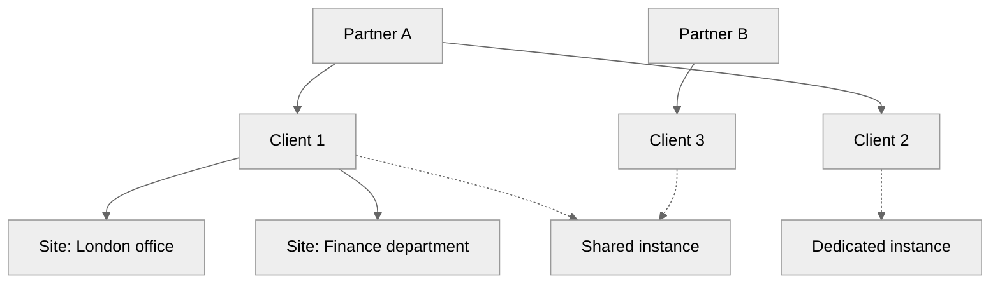
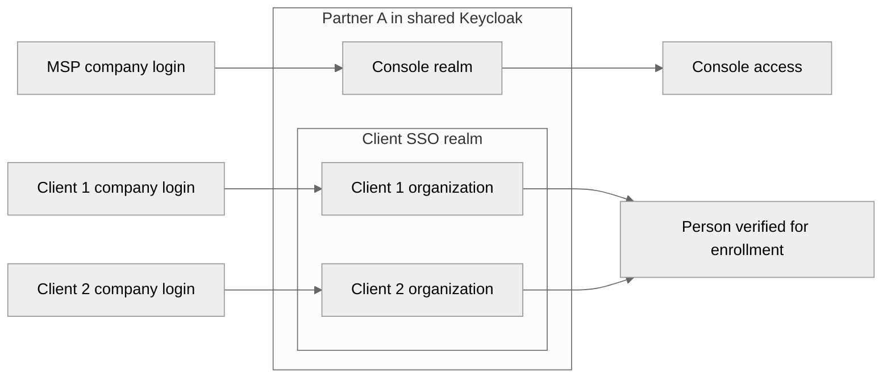
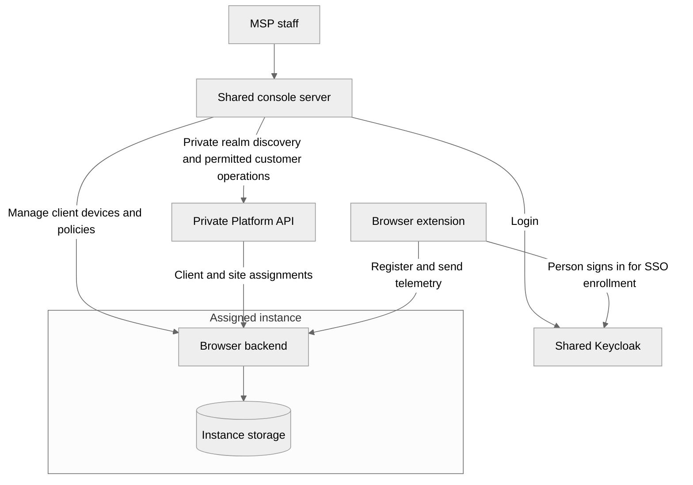
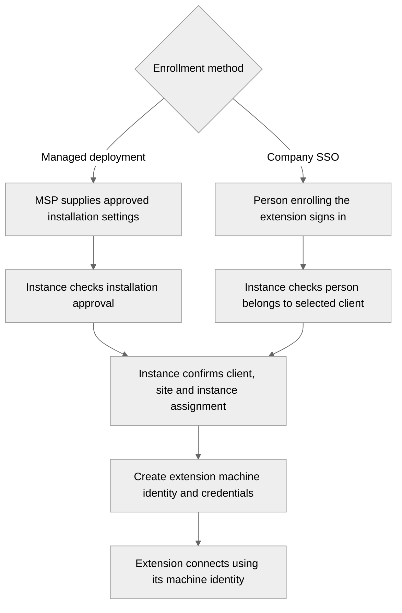

# ADR-000: Identity and access for MSP customers

**Status:** Proposed

**Date:** 2026-11-13

**Scope:** Customer ownership, console users, extension machine identities, and service responsibilities. Separate authentication API ADRs will define login flows, credentials and API access checks.

## Context

Mutex must let a managed service provider (MSP) manage its customers from one console. Customers can share an instance with customers of the same or another MSP. A customer can also have a dedicated instance.

Initially, only MSP staff use the console. Each installed browser extension has its own machine identity. Extensions must support both installation through a company's device management system and enrollment through company single sign-on (SSO). Company SSO identifies the person enrolling the extension; it is not the extension's identity.

The design must keep three things separate: who owns a customer, who can access its data, and which instance serves it.

## Decision

Use the hierarchy **partner → client → site**. Each client belongs to one partner and uses one assigned instance.

Use shared Keycloak infrastructure for people signing in. Give each partner a **Console realm** for console users and a **Client SSO realm** for people enrolling extensions through company SSO. A realm is a separate area in Keycloak with its own accounts and login settings. Within the Client SSO realm, each client has a Keycloak organization. Connect that organization to company SSO when SSO enrollment is enabled. Clients using only managed deployment do not need an SSO connection or human enrollment accounts.

The Platform API records ownership, staff permissions and instance assignments. Each instance registers extension machine identities, manages their connection credentials, applies client policies and receives telemetry—the activity data sent by extensions.

**Keycloak verifies people; the assigned instance registers and verifies extensions.** The Platform API supplies ownership and instance assignments. It does not perform company SSO login or issue extension credentials.

For MSP console login, Platform maps registered MSP email domains to the partner's Console realm. The console server performs this private lookup before login. Discovery selects a login destination; it grants no customer access. Extension SSO discovery and client employee console access will be addressed separately.

## Customer ownership

| ID | Represents | Relationship |
| --- | --- | --- |
| `partner_id` | The MSP | Unique within the environment. A partner can have many clients. |
| `client_id` | A customer | Unique within its partner. A client belongs to exactly one partner. |
| `site_id` | An office, region, department or other customer grouping | Unique within its client. A site belongs to exactly one client. |
| `instance_id` | The running services and storage assigned to a customer | A client and all its sites use one instance. An instance can serve clients from several partners. |
| `installation_id` | One registered extension installation | Belongs to one client and site, served by that client's assigned instance. It is separate from a person or physical device ID. |

Solid lines show ownership. Dashed lines show instance assignment. Every client follows the same site model; only client 1's sites are shown.

Partner, client, site and instance IDs use four-digit numbers from `1000` through `9999`. Client numbers repeat across partners, and site numbers repeat across clients. A client is therefore identified by `(partner_id, client_id)` and a site by `(partner_id, client_id, site_id)`. All services must preserve those parent IDs. Installation and Keycloak account IDs keep their existing formats. [ADR-001](adr-001-platform-api.md#ids-and-url-paths) defines allocation and URL paths.

IDs remain the same when names or domains change and are not reused for different records within the same parent. Platform is the authority for partner, client and site ownership and instance assignment. Each instance is the authority for its registered installations. The system checks that each site belongs to the selected client and that the client belongs to the selected partner.

Partner bootstrap includes an initial client `1000` and site `1000`. They follow the same ownership and access rules as later records. Authorized MSP administrators create additional clients and sites through the console.

Policies are managed independently for each client. Sites group devices, policy settings and reports. Staff can be restricted to assigned sites. A site's country or department is a label for organization; it does not determine where data is stored.

Customers cannot belong to multiple MSPs. Moving a customer between MSPs is outside this decision.

## People and extension identities

This ADR distinguishes the following human and extension identities. Only the first two are accounts in Keycloak. Identities used by services calling other services belong in the authentication API ADRs.

| Identity | Represents | Managed by | Purpose |
| --- | --- | --- | --- |
| Console user | An MSP technician or administrator | Partner's Console realm | Signs into the console. Platform permissions determine the allowed clients, sites and actions. |
| Client SSO user | A person signing in through a client's company account | Client organization in the partner's Client SSO realm | Provides evidence that the person enrolling an extension belongs to the selected client. Gives no console access. |
| Extension machine identity | One installed extension | Assigned instance | Identifies the installation when it retrieves policies and sends telemetry. |

A machine identity identifies the extension installation, not its current user. Multiple installations on the same computer remain separate identities. An installation can be associated with a device record. For SSO enrollment, it must also record the verified person and client organization used during enrollment. Those associations do not replace its own identity.

### Keycloak realms

Each partner has a Console realm and a Client SSO realm. The names describe their purpose rather than a person's employment status.

Every partner gets the same separation. A client can have its own SSO connection without needing its own realm. This uses Keycloak's existing [Organizations feature](https://github.com/keycloak/keycloak/blob/26.3.3/docs/documentation/server_admin/topics/organizations/intro.adoc).

Platform records which partner owns each realm and which client belongs to each organization. Services use those registered relationships, not realm names, email addresses or a client ID supplied by the caller. A shared Client SSO realm alone does not identify a client; the verified organization is also required. Keycloak provides [organization membership information](https://github.com/keycloak/keycloak/blob/26.3.3/docs/documentation/server_admin/topics/organizations/mapping-organization-claims.adoc) for this check.

Organizations within a Client SSO realm share its account directory and realm-wide login settings. They do not provide the same separation as individual realms. If a client needs a fully separate account directory or incompatible login settings, reconsider a realm for that client.

A person who uses both the console and SSO enrollment has separate Keycloak accounts and sessions for those purposes. Future customer access to the console requires a separate decision about administrative accounts and permissions. Membership in a client organization does not grant console access.

Record people using their Keycloak realm and permanent user ID. Email addresses can change or be reassigned; a matching email must not merge accounts or transfer permissions.

The two realms may connect to the same company login system. That system may recognize an existing login and skip another password prompt. Separate Mutex sessions therefore do not guarantee repeated password entry. Additional login checks for console users belong in the authentication ADRs. See [Microsoft's guidance on identity and SSO](https://learn.microsoft.com/en-us/azure/architecture/guide/multitenant/approaches/identity).

### Extension machine identity

The assigned instance creates a machine identity when an extension is approved for enrollment. The identity belongs to one partner, client and site. The instance issues the credentials the extension uses to connect.

Managed deployment can register an extension without a human login. SSO enrollment adds a check of the enrolling person's client membership. Both methods produce the same kind of extension machine identity. The instance records the approved enrollment method; an extension cannot declare itself managed to bypass SSO renewal checks.

The extension uses its machine credentials to send telemetry and retrieve policies assigned to its installation. These credentials give no console access or authority to change policies. For SSO enrollment, continued renewal depends on the enrolling person's company SSO access and membership in that client organization. Managed deployment does not have this dependency on a person's login.

## Service responsibilities

| Service | Responsibility | Placement |
| --- | --- | --- |
| Keycloak | Console login, client SSO login and the associated human accounts | Shared per environment, with separate realms for each partner and purpose. |
| Platform API and its database | Partner, client and site records; staff permissions; instance assignments; registered console domains; setup of realms and organizations | Private, shared per environment. |
| Console | Staff login experience, private Platform calls, customer/site selection and management screens | Shared application with a public interface and server-side private network access. |
| Browser backend | Extension machine identities and credentials, device approval, client policies, telemetry and access to client data | One deployment per instance. |
| Instance storage | Device records, policies, telemetry and extension connection state | Separate storage per instance. Clients sharing an instance still require separate data access checks. |

The diagram shows responsibilities, not a prescribed API call sequence. The authentication API ADRs will define how services verify requests and obtain current permissions.

Keep extension registration and telemetry collection in the browser backend initially. They do not need separate services for this model. A dedicated instance runs the same services with one client assigned to it.

Platform maintains the list of customers and where they run. Each instance serves only its assigned clients. Missing or conflicting ownership information must not grant access. This follows the customer-directory and setup responsibilities described in [Microsoft's control-plane guidance](https://learn.microsoft.com/en-us/azure/architecture/guide/multitenant/approaches/control-planes).

## How access works

### MSP staff

Staff enter their email in the shared console. Its server resolves the domain through Platform and starts login in the registered partner's Console realm. A partner can register several authorized domains; each domain maps to only one partner for console login. Unknown domains do not fall back to another realm. The shared instance does not determine the login realm, and client or site selection is not needed for discovery. [ADR-001](adr-001-platform-api.md#msp-console-realm-discovery) defines this lookup.

After authentication, a partner administrator with full access sees that partner's clients and sites. Restricted technicians see only their permitted records. The technician does not need an account in every client's SSO organization. The console server forwards management requests privately; Platform checks the verified staff identity and permissions itself.

Permissions describe both what a person can do and where they can do it. Access to an entire partner must be explicitly assigned. Someone restricted to one site cannot use reports, exports or policy screens to reach another site. Staff cannot give themselves or others more access than they are allowed to assign.

Each service checks permissions; hiding a button in the console or reaching a private service is not sufficient. Client and site restrictions apply to stored data, cached results, reports, exports and work performed in the background. Changes record who performed the action and which client or site it affected. The mechanism for sharing and checking permissions belongs in the authentication API ADRs.

The established MSP pattern is to use staff identities from their own organization with explicit access to customer resources, as illustrated by [Azure Lighthouse](https://learn.microsoft.com/en-us/azure/lighthouse/concepts/architecture). Mutex retains its simpler rule that each client belongs to one MSP.

### Browser extension

Both enrollment methods create an extension machine identity under one partner, client, site and instance.

In managed deployment, the company's device management system supplies the installation settings. No person needs to sign in. In SSO enrollment, Keycloak verifies the person through the selected client's approved company login and the instance checks their client organization before registering the extension. A login for another client is not sufficient.

An email address or company domain alone does not establish which client owns an extension. Client and site selection must follow enrollment settings approved by authorized MSP staff. The instance checks that selection against the records maintained by Platform and confirms that it is the instance assigned to the client. The extension cannot choose an arbitrary site merely because it exists.

The instance records the extension's ownership. Changing it requires an authorized management action; a request from the extension cannot choose a different client or site. Changing the selected customer in the console also cannot change where the technician's own extension sends data.

Already registered extensions communicate with their assigned instance without calling Platform or Keycloak for every event. The authentication API ADRs will define credential renewal, removal of access and how long operation can continue during an outage.

## Alternatives and tradeoffs

| Option | Assessment |
| --- | --- |
| One realm for console login and SSO enrollment | Shares human accounts and sessions across two purposes that must remain separate. |
| One Console realm per partner and one Client SSO realm per client | Provides stronger separation between client account directories. Keep this option for clients that need it; different SSO connections alone do not require it. |
| One Console realm and one Client SSO realm for all partners | Reduces the number of realms, but combines partners' accounts and login settings. Separate partner realms fit the chosen ownership model. |
| One realm per instance | Couples customer identity to deployment location. It does not fit instances shared across MSPs. |

The proposal uses two realms for human accounts per partner and one organization per client. Extension machine identities remain with the assigned instance. This separates console access from enrollment and lets clients choose their own SSO connections. It also requires consistent setup of realms, organizations and permissions.

Shared services have shared risks. A Keycloak outage can affect new logins across partners. A Platform outage can affect customer management and setup. Administrative access to these shared services can affect multiple partners. A dedicated application instance provides separate application resources; it does not provide separate Keycloak or Platform services.

## Architecture review

These scenarios check the design's rules. They are not runtime or load-test results.

| Scenario | Expected behavior |
| --- | --- |
| Two MSPs share an instance | Each can access only its own clients, devices and data. |
| MSP staff enter their email before login | The registered domain selects their partner's Console realm, without returning customer records or granting access. |
| A technician is assigned one site | Other sites remain inaccessible through screens, direct requests, reports and exports. |
| A person enrolls an extension through company SSO | The instance creates a separate machine identity. Enrollment gives no console access. |
| An extension is installed through managed deployment | The instance creates a machine identity without requiring a human account. |
| An SSO-enrolled extension claims to be managed | Its recorded enrollment method remains unchanged; SSO renewal checks still apply. |
| A technician changes the selected client in the console | Their extension keeps its registered ownership. |
| Two clients use the same email domain | Enrollment uses the selected client organization and verified membership, not the domain alone. |
| A person has a login for another client in the same realm | That login alone cannot enroll an extension for the selected client. |
| A company reassigns an email address | The new account does not inherit the previous person's permissions or installation associations. |
| An extension reaches the wrong instance | That instance refuses to register it or accept its data. |
| Staff access is removed | Services stop allowing the removed permissions within the time limit defined by the authentication ADRs. |
| A person loses company SSO access | Renewal of their SSO-enrolled extension's credentials is refused once the loss of access is detected. When its remaining credentials expire or are disabled, the extension stops sending telemetry and requires sign-in. |
| A device changes site while older events await upload | Older events keep their original site association or are held for review. They are not silently assigned to the new site. |
| A customer sends unusually high telemetry volume | Per-client limits protect other clients sharing the instance. |

## Loss of SSO access

An SSO-enrolled extension must eventually lose access when the enrolling person loses company SSO access or membership in the client organization. Credential renewal must check that continued access and refuse renewal when it has been removed. Once the extension has no valid credentials, it stops authenticated communication, including telemetry and policy retrieval, and returns to a sign-in-required state. The MSP does not have to remove the device to stop its access.

This is a required renewal rule, not an automatic consequence of using SSO. Renewing only the instance-issued machine credentials would not establish whether the person still has company access. The authentication API ADR must define how that access is checked and the maximum time between its removal and the extension losing access. An existing Keycloak session alone is not sufficient evidence of continued company access. If access cannot be checked, renewal must not continue indefinitely; the same ADR must set the allowed outage period.

Extensions enrolled through managed deployment follow the device approval and removal process instead.

## Separate ADRs

Separate authentication API ADRs will define:

- Console login, domain authorization verification and company SSO enrollment steps. Extension discovery and client employee console access remain separate decisions.
- How extension machine identities are created and disabled, and how their credentials are checked and renewed.
- How services verify staff permissions and calls from other services.
- How loss of company SSO access prevents credential renewal, the maximum delay before extension access ends, and how outages are handled.

Customer scale and data-location commitments also need to be established before choosing production capacity and regions. A site label or dedicated instance alone makes neither guarantee.
