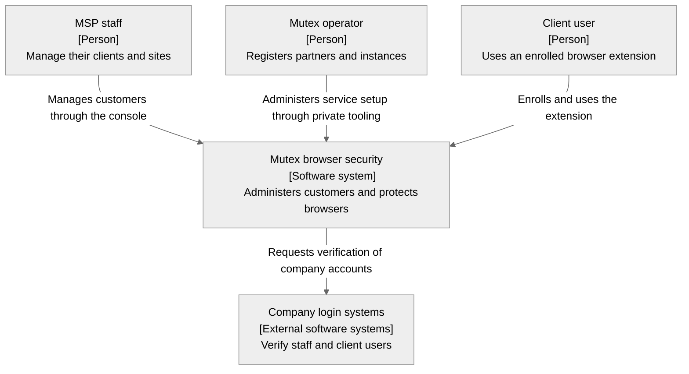
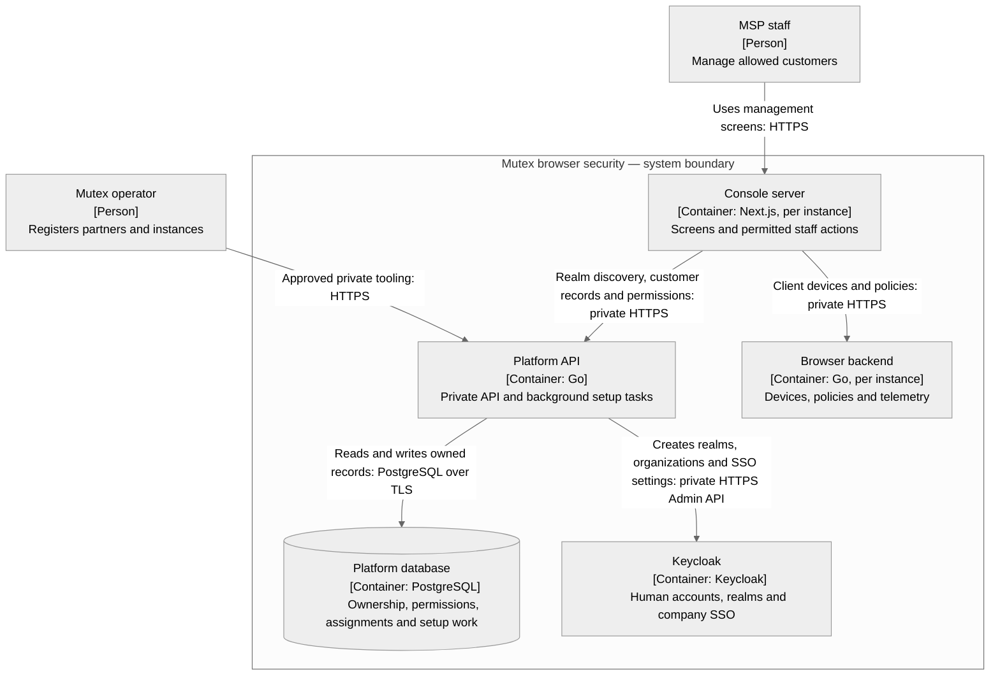
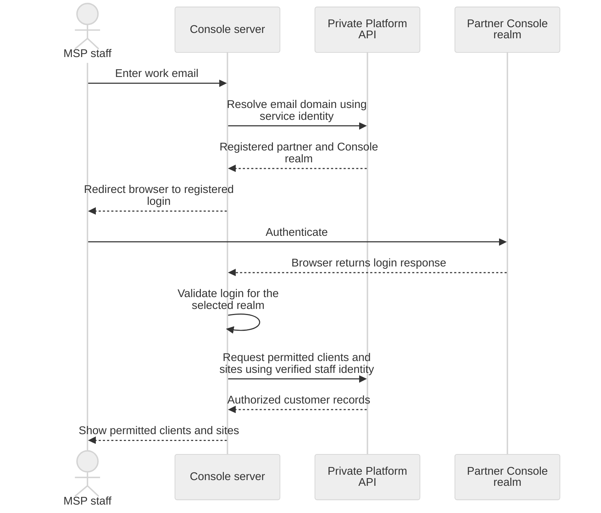
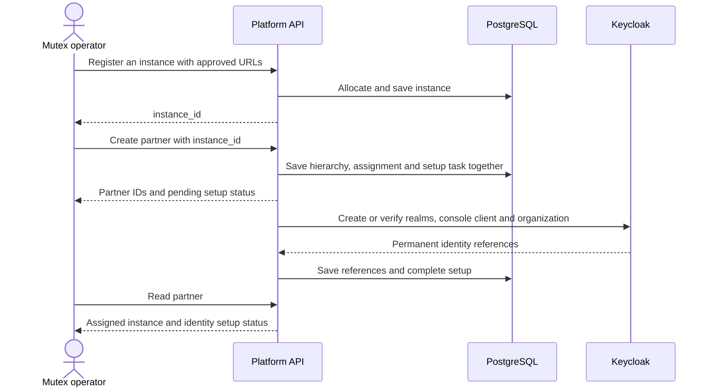

# ADR-001: Internal Platform API

**Status:** Proposed

**Date:** 2026-11-13

**Related:** [ADR-000: Identity and access](adr-000-identity-and-access.md)

**Scope:** Platform responsibilities, private access, PostgreSQL records, customer ID paths, MSP console realm discovery and reliable setup. Login and credential verification belong in separate authentication API ADRs.

## Context

Mutex needs one place to record MSPs, their clients and sites, staff permissions, and the instance assigned to each client. The browser control plane already manages devices, policies and telemetry within an instance. Its existing `platformapi` package serves those console features; it is not the shared Platform API described here.

Creating a customer and creating infrastructure are different operations. A new client can join an existing instance without creating a namespace, database server or deployment.

## Decision

Build one internal Go application per environment, backed by its own PostgreSQL database. It serves private APIs and runs small background setup tasks in the same application. PostgreSQL records both requested changes and unfinished work so setup can resume after a restart. A separate queue service or worker deployment is not required initially.

Platform has no public hostname, public ingress or publicly reachable API endpoint. The console server, registered instance services and approved operator tooling call it over private connections. Browsers and extensions never call it directly. The public console exposes specific staff operations; its server authenticates the user and forwards those operations to Platform over the private network. Console realm discovery is available before staff login, through the console server only.

Private access does not establish permission. Platform verifies the calling service and, for staff actions, the person and their allowed partner, client or site. The authentication ADRs define how callers prove those identities.

This separates customer records and setup from instance operation, following [Microsoft's control-plane guidance](https://learn.microsoft.com/en-us/azure/architecture/guide/multitenant/approaches/control-planes).

## C4 level 1: Mutex system context

This [C4 system-context view](https://c4model.com/diagrams/system-context) shows Mutex as a whole. Platform is an internal part of that system.



**Key:** Boxes identify people or software systems. Arrows show a named interaction or dependency; they do not imply public network access.

## C4 level 2: Platform and its connected applications

This focused [C4 container view](https://c4model.com/diagrams/container) shows Platform and its connected applications. A C4 container is an application or data store. Each box names its technology and responsibility.



**Key:** The boundary contains Mutex applications. Rectangles are applications; the cylinder is a database. Arrows point from caller to dependency. Platform and its database are private. Public console and login interfaces are separate. Login flows, the extension and instance storage are omitted here; see ADR-000 for their responsibilities.

## Responsibilities

| Area | Platform owns | What remains elsewhere |
| --- | --- | --- |
| Customer directory | Partners, clients, sites and their relationships | Instance device records and telemetry. |
| Staff access | References to console users and their permitted actions and customer/site access | Keycloak owns human accounts and login. Each service enforces access to its own resources. |
| Instance directory | Instance IDs, approved console and backend addresses, availability for new assignments and each client's assigned instance | Existing infrastructure tooling creates and operates deployments. |
| Identity setup | Registered realm and organization relationships; requested SSO setup and its progress | Keycloak stores the actual login configuration. Instances perform extension enrollment. |
| Console realm discovery | Registered MSP email domains mapped to their partner's Console realm | The console starts login; Keycloak authenticates the person. |
| Change history | Who changed Platform records and the result of setup work | Device, policy and incident history remains in its instance. |

MSP administrators with the required permissions create clients and sites and manage staff access within their partner. Mutex operators register partners and instances and select the instance for a client. A partner administrator cannot choose another partner, assign arbitrary infrastructure or grant access beyond their authority.

The first partner administrator is assigned by an authorized Mutex operator. Partner membership is not inferred from an email domain or from being the first person to log in.

Partner bootstrap requires a registered instance and creates the partner, initial client `1000`, initial site `1000` and client assignment together. These are ordinary client and site records, not a shared bucket for unrelated customers. Their names are supplied during setup. MSP administrators can create further clients and sites through the console; no separate bootstrap endpoint is needed.

The existing browser backend keeps policy editing and delivery, device approval and reset, enrollment credentials, application usage, incidents and reports. Platform does not proxy those operations or access instance ClickHouse and Redis databases. The console server uses Platform's approved assignment to reach the correct instance, and the instance checks the request itself.

Each instance has its own console origin. One instance can serve clients from several partners. Platform derives its console client ID as `platform-ui-{instance_id}` and its public-key URL as `{console_url}/.well-known/jwks.json`; callers do not supply credentials or arbitrary key URLs during registration. The same instance client ID is registered separately in each partner Console realm it serves. Signed client assertions let that UI use one signing key across those registrations. Platform registers the public-key source and never holds the UI's private key. UI login, refresh, logout and key publication belong to the console implementation.

## IDs and URL paths

Use four-digit decimal numbers from **1000 through 9999**, inclusive. URL IDs must contain exactly four decimal digits in this range. Numbers are allocated separately within each parent. The URL path provides the hierarchy; numeric prefixes do not encode a record's type, region or deployment.

| ID | Unique within | Capacity |
| --- | --- | --- |
| `partner_id` | The environment | 9,000 partner IDs. |
| `client_id` | One partner | 9,000 client IDs per partner. |
| `site_id` | One client within its partner | 9,000 site IDs per client. |
| `instance_id` | The environment | 9,000 instance IDs. |

These are numbering limits, not service capacity guarantees.

For example, both partners below may have a client `1000` and a site `1000`. The full paths identify different records:

```text
/internal/v1/partners/1000/clients/1000/sites/1000
/internal/v1/partners/1001/clients/1000/sites/1000
```

A client reference always includes `(partner_id, client_id)`. A site reference always includes `(partner_id, client_id, site_id)`. This applies to API bodies, database relationships, configuration sent to instances, permission checks, logs and cached results. A bare `client_id` or `site_id` is not a complete identity.

These short IDs apply to the customer hierarchy and instance directory. Keycloak account IDs and extension `installation_id` values retain their existing identity-system formats. Request retry keys are metadata, not four-digit customer IDs.

The table describes the intended management resources. The current implementation supports instance registration/read/availability and partner creation/read only; the README lists the implemented endpoints. Resource paths do not imply general editing or deletion support.

| Private path | Required operations |
| --- | --- |
| `/internal/v1/partners` | Operator creates a partner with its initial client and site. |
| `/internal/v1/partners/{partner_id}` | Read the permitted partner record; operators control its enabled state. |
| `/internal/v1/partners/{partner_id}/clients` | List permitted clients or create a client under this partner. |
| `/internal/v1/partners/{partner_id}/clients/{client_id}` | Read or update permitted client details. Creation includes the approved instance; ordinary updates do not move clients. |
| `/internal/v1/partners/{partner_id}/clients/{client_id}/sites` | List permitted sites or create a site under this client. |
| `/internal/v1/partners/{partner_id}/clients/{client_id}/sites/{site_id}` | Read or update permitted site details. |
| `/internal/v1/console/realm-discovery` | Console server submits an email domain and receives its registered partner and Console realm. |
| `/internal/v1/instances/{instance_id}` | Operator reads the registered instance or changes its availability for new assignments. Address changes require a coordinated login-configuration workflow. |

Use `GET` for reads and lists, `POST` for creation and realm discovery, and `PATCH` for permitted record updates. Operator instance registration uses `POST /internal/v1/instances`. Staff-permission operations remain required, but their contract belongs with the authentication ADRs. A dedicated client SSO management endpoint is deferred until its workflow is defined.

Creation uses the parent collection, such as `POST /internal/v1/partners/1000/clients`; Platform allocates the new number. Callers cannot override the parent from a request body. Lookups use the complete parent path and never fall back to searching by a client or site number alone. Short IDs are easy to guess, so permission checks are required for every lookup and change.

### PostgreSQL rules

Use integer columns with a `1000–9999` constraint. Enforce unique partners and instances, unique clients within a partner, and unique sites within a client. Database relationships use the full parent keys, so a site cannot refer to a client in another partner. Each active client has exactly one instance assignment, and all of its sites use that instance. A client awaiting assignment cannot be ready.

Allocate numbers using a counter for each ID type and parent, updated within the same transaction that creates the record. Concurrent requests must not receive the same number. Do not allocate by reading the largest existing ID and adding one. Partner bootstrap saves the partner, default client and default site with their setup work in one transaction. A retried creation request uses its recorded request key to return the original records and setup status. Bind that key to the caller, operation, parent and request contents; conflicting reuse is rejected, and retries still require current permission.

IDs are not renumbered or reused after retirement. Consequently, the four-digit range permits 9,000 lifetime allocations within each scope, not 9,000 simultaneously active records. Exhaustion returns an explicit capacity error; it must never wrap to `1000` or silently produce a fifth digit. Expanding the range requires a later contract change.

Platform alone writes its database. It does not write directly to Keycloak's database or any instance database. Store references to protected SSO secrets rather than putting them in ordinary customer records, responses or change history. The authentication ADRs define how those secrets are supplied and rotated.

## Private access

| Caller | Allowed responsibility |
| --- | --- |
| Console server | Resolve a registered console realm before login; perform management operations only for a verified console user within that person's permissions. |
| Registered browser backend | Future integration must restrict configuration and permission lookup to clients assigned to that instance. Its delivery contract is deferred. |
| Approved operator tooling | Perform explicitly authorized partner, instance and initial-administrator setup. |

Bind the service identity to its permitted role and, for a browser backend, its registered `instance_id`. An instance cannot read another instance's configuration by changing the URL. Platform independently checks the staff identity supplied through the console; the console's service identity alone does not grant partner-wide access.

Restrict network access to these callers and use encrypted service connections. Health and diagnostic endpoints are private as well. The console must use approved backend addresses from Platform rather than accepting a destination URL from the browser. No generic public forwarding endpoint should expose Platform's private routes.

The console exposes only supported staff operations. Operator registration and instance configuration routes are not forwarded to browsers. Realm discovery requires the console's service identity, but no staff session; it grants no access to customer records.

Credentials used for Keycloak administration stay with Platform's setup work. They are not returned to the console, instances or extensions. Staff requests select records they are authorized to manage; they cannot supply arbitrary Keycloak admin URLs or operations.

## MSP console realm discovery

During partner SSO setup, register the MSP's authorized email domains against its partner and Console realm. A partner can have several domains. Each normalized domain belongs to exactly one partner for console discovery, enforced by a PostgreSQL uniqueness constraint. Match complete domains, not suffixes; subdomains must be registered separately. Activate a mapping only after domain authorization is verified and the registered Console realm is ready. The authentication ADR defines the verification method.

The console accepts the staff email and submits only its domain to Platform. Platform returns the registered partner and Console realm for an active mapping. The response contains no user-account lookup, client/site directory, permissions or instance addresses. Unknown domains and disabled partners cannot resolve to another partner or a default realm.



This illustrates responsibilities, not the authentication protocol. The console binds the selected realm to the login attempt and verifies the returned identity before requesting customer records. A typed email is a routing hint, not proof of membership. A partner administrator with full access sees all clients and sites under that partner; restricted staff see only their permitted records, even when several MSPs share an instance.

Reuse the existing console server for this flow; no discovery service is needed. This follows the established [home realm discovery pattern](https://learn.microsoft.com/en-us/entra/identity/enterprise-apps/home-realm-discovery-policy). The authentication ADR will define the login exchange and protection of the public discovery entry point. Extension SSO discovery and client employee console access are deferred; this endpoint serves neither case.

## Customer setup

Register an instance before creating a partner. Partner creation includes `instance_id` and saves the partner, initial client, initial site, client assignment, setup task and change history in one PostgreSQL transaction. One instance can serve clients from several partners. Sites inherit their client's assignment.

Background setup creates or verifies the two partner realms, the assigned instance's console client and the initial client organization. A client using managed deployment does not need a company SSO connection. Save the permanent identity references and reuse them on retries; a matching display name alone does not prove ownership.



Setup tasks survive application restarts. PostgreSQL coordinates replicas with expiring leases. External calls have deadlines, and retries do not hold a transaction open during network calls. A replaced worker cannot complete an older attempt.

Configuration delivery to instances and confirmation that they have applied it are deferred until the browser-backend integration is defined. There is no assignment-fetch or revision-acknowledgement API in this scope. Identity setup completion does not claim that a UI or instance has applied its configuration.

Moving an active client to another instance, moving clients between partners and permanent deletion require separate lifecycle designs. Ordinary updates cannot change ownership or assignment.

## Failures and service independence

If Platform or PostgreSQL is unavailable, directory changes and new setup stop. Existing instances continue with their last valid configuration only within the access and freshness limits defined by the authentication ADRs. An offline instance retains its assignment; Platform does not move its clients automatically.

Platform is not called for each telemetry event and does not relay extension traffic. The authentication ADRs must define permission checks, configuration validity periods and the maximum delay before disabled access is enforced. An outage cannot preserve revoked access indefinitely.

## Reuse and limits

| Existing code or configuration | Treatment |
| --- | --- |
| Customer/realm mappings in the browser backend's issuer registry | Move ownership of these records to Platform. Instances retain verification logic. Replace the old one-realm-to-one-client assumption with the registered organization relationship. |
| Keycloak setup scripts | Reuse relevant application settings and setup operations, adapted to the two-realm partner model. Do not adopt their old realm layout unchanged. |
| Console server forwarding | Reuse it for supported Platform operations and the selected client's approved instance. Add console realm discovery before login; require staff authentication for management operations. |
| Existing `platformapi` handlers | Keep devices, policies, incidents, reports and enrollment-token operations in the instance. |
| Existing `/users` directory | Keep customer activity identities in the instance. It is not the new MSP staff-permission directory. |
| Existing deployment tooling and application catalog | Continue using them. Platform does not become an infrastructure deployer or catalog service. |

Do not add billing, a central device database, global policy inheritance, cross-customer analytics or an event bus to this first version. Partner/client/site records, staff permissions and the instance directory are new Platform capabilities, not existing handlers that can simply be moved.

## Alternatives and consequences

| Alternative | Reason for the chosen approach |
| --- | --- |
| Move all existing console APIs into Platform | Couples shared administration to every instance's operational data and duplicates responsibilities already handled by the browser backend. |
| Keep ownership only in each instance's deployment files | Gives no common authority for MSP access or customers sharing an instance. |
| Expose Platform directly to browsers | Conflicts with the internal-only boundary. The console server already provides the staff-facing entry point. |
| Give partners, clients and sites separate reserved numeric bands | Wastes the limited four-digit space. Parent-scoped paths provide separation without reducing each scope below 9,000 IDs. |

One internal application and PostgreSQL are sufficient for the initial scope. They add a shared dependency for customer setup and administration, and privileged Keycloak setup makes Platform an important security boundary. Keeping instance data and extension credentials local limits the work and access that Platform needs.

## Architecture stress review

This review checks the design against failure and misuse scenarios. It is not a runtime test or a capacity claim.

| Scenario | Required outcome |
| --- | --- |
| Two partners both have client `1000` and site `1000` | Full parent keys keep their records, permissions and instance configuration distinct. |
| Partner bootstrap is retried after a lost response | Return the same partner, initial client `1000` and site `1000`; do not allocate another hierarchy. |
| Two partners register the same console domain with different letter casing | Normalization and the database constraint reject the conflicting registration. |
| Someone enters another MSP's email domain | Discovery selects that MSP's login only. Authentication and staff permissions are still required. |
| A domain is unknown or its partner is disabled | Do not return a default realm or customer records. |
| A login response belongs to a different realm than the selected one | Reject it; do not use it to request the selected partner's customer records. |
| Two requests create a client simultaneously | The PostgreSQL allocation transaction gives them different IDs within that partner. |
| A creation response is lost and retried | The recorded request key returns the same client and setup result. |
| An ID range reaches `9999` | Reject the next allocation explicitly; never wrap, reuse or silently expand the ID. |
| A caller guesses another partner's path | Authorization rejects access before returning or changing that partner's records. |
| Keycloak succeeds, then Platform stops before saving the result | A retry identifies and verifies the previously created resource; it does not create another organization or adopt one by display name alone. |
| Database commit succeeds, then the application restarts | The persisted setup task remains available for retry. |
| Keycloak setup fails for one client | Record the failure and keep that setup incomplete. Other clients continue with completed configurations; access-removal updates are not blocked. |
| PostgreSQL is unavailable during a change | Reject the operation rather than claim the requested change was saved. |
| An older setup task completes late | Its expired or replaced lease prevents it from recording completion. |
| Staff permission is removed while the console remains open | Services enforce the updated permission within the authentication ADR's limit; the console session alone cannot preserve access. |
| An MSP tries to create a customer on an unapproved instance | Platform rejects creation before saving the hierarchy or allocating IDs. |
| A setup error contains a secret | Return a safe error summary and reference; keep credentials out of responses and ordinary logs. |
| A client uses managed enrollment without SSO | Setup requires the client organization and instance configuration, but no company login connection. |

The remaining authentication ADRs must supply the enforcement mechanisms and time limits referenced above. They must preserve these ownership, private-access and readiness rules.
