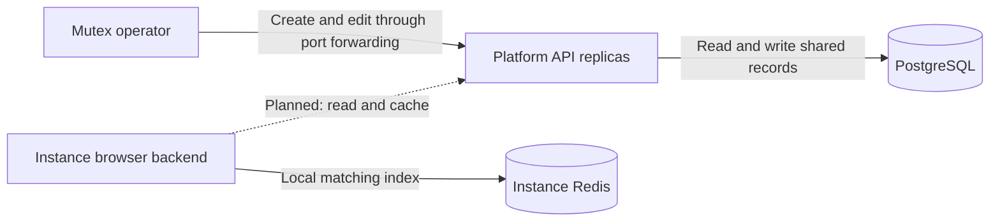

# ADR-002: Global application registry

**Status:** Accepted

**Date:** 2026-11-14

**Related:** [Internal Platform API](adr-001-platform-api.md)

## Context

The browser backend embeds the application catalog and copies it into ClickHouse. Platform needs an editable registry shared by all its replicas. Application definitions are global; customer usage, policies and telemetry remain instance data.

## Decision

Store the registry in PostgreSQL. Operators create and replace definitions through private, port-forwarded API calls. The four routes and request examples are documented in the [README](../../README.md#application-registry). Keep the existing private operator access model.

The dashed connection is planned CP integration. The registry starts empty; startup does not seed data or overwrite operator edits. Moving the existing catalog requires preserving its IDs and correcting conflicting host claims first.

## Records and ownership

| Table | Stored values | Indexes |
| --- | --- | --- |
| `platform.applications` | Permanent ID, JSONB definition, revision, UTC record times and creation request key/hash. | Primary key on ID; unique slug index; unique creation request key. |
| `platform.application_hosts` | Normalized host pattern and owning app ID. | Primary key on pattern; app-ID index and foreign key. |

Retain the catalog-v3 fields and 12-character hexadecimal app IDs. IDs, revisions and host claims each have one authoritative stored representation; read responses assemble the complete app. Customer hierarchy numbering is unchanged.

Go normalizes and validates definitions before writes, using the existing JSON Schema and standard IDNA tooling. Host normalization must be stable when repeated. Remove `www` subdomain aliases while preserving registrable names such as `www.com`; retain wildcard patterns. Dependencies must identify existing apps other than the edited app. Preserve explicit empty values and the schema's `unknown` values.

A normalized pattern belongs to one app, enforced by the host table's primary key. Distinct overlapping patterns remain a matching concern: an exact host and a wildcard are not duplicate stored values. CP retains exact-match precedence. This registry does not choose owners for ambiguous claims by timestamp.

## Consistency and failures

Create or replace the definition and host claims in one transaction. Creation keys and normalized request hashes make retries safe across replicas without overwriting later edits. Conditional updates check and increment the revision atomically, preventing lost edits. A conflict rolls back the entire write.

Go supplies UTC timestamps; PostgreSQL stores `timestamptz`. Complete reads use one SQL statement so definitions and hosts come from the same database snapshot. Storage failures return errors rather than an apparently successful empty registry. The embedded validation schema compiles at startup so a broken schema cannot leave a running service unable to validate writes.

CP matching, cache integration and existing catalog import are separate work. This decision adds no delete, partial-update or distribution workflow.
