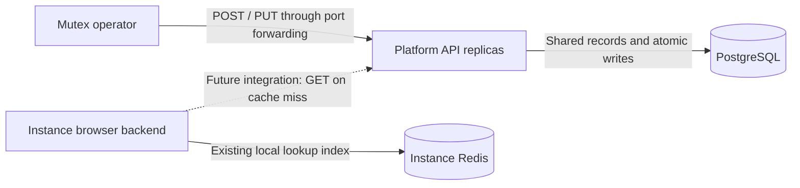

# ADR-002: Global application registry

**Status:** Accepted

**Date:** 2026-11-14

**Related:** [Internal Platform API](adr-001-platform-api.md)

## Context

The browser backend embeds a curated application catalog and copies it into ClickHouse. That couples the source of shared app definitions to instance releases. Platform needs a shared, editable registry that every replica reads from the same PostgreSQL database.

These records describe applications and shared login providers. Customer usage, policies and telemetry are separate instance data. The registry is global and has no partner, client or site ownership columns.

## Decision

Store app definitions in Platform's PostgreSQL database. Mutex operators create and edit records through private, port-forwarded API calls. CP consumes read operations; its cache and matching implementation are separate work. Retain the existing private operator access model.

The dashed connection identifies planned CP integration. The four Platform routes are implemented by this decision.

| Method | Path | Behavior |
| --- | --- | --- |
| GET | `/internal/v1/applications` | Complete collection, including identity records, ordered by app ID. |
| GET | `/internal/v1/applications/{app_id}` | One complete app and an edit ETag. |
| POST | `/internal/v1/applications` | Create a definition with a generated, permanent ID and retry-safe request key. |
| PUT | `/internal/v1/applications/{app_id}` | Replace the editable definition only if its ETag still matches. |

Preserve the catalog-v3 fields. Inputs exclude server-owned IDs, revisions and write timestamps. Read responses include the assembled app document and UTC record timestamps. New IDs use the existing 12-character hexadecimal format; customer hierarchy numbering is unchanged. Existing catalog records are not automatically imported or assigned new IDs by this implementation.

## Validation and normalization

Go validates definitions before SQL writes, using the existing JSON Schema through a standard Go validator. Normalize names and other string values by trimming surrounding whitespace. Lowercase slugs and kinds. Normalize DNS hosts with IDNA tooling, reject URLs/ports/IPs, remove a trailing dot and use ASCII punycode. Exact resolver hosts omit `www.` because CP already treats it as an alias. Preserve wildcard patterns and homepage preference order. Sort and deduplicate resolver hosts and dependency IDs before computing creation request hashes.

Use the current application schema's categories, subcategories, capabilities and cross-field rules. Preserve explicit empty and unknown values. Dependencies must identify existing apps other than the edited app. PostgreSQL's role is transactional storage and uniqueness, not application-definition validation.

## Tables and indexes

| Table | Stored values | Indexes |
| --- | --- | --- |
| `platform.applications` | Permanent ID, JSONB definition, revision, UTC record times and creation request key/hash. | Primary key on ID; unique slug expression index; unique creation request key. |
| `platform.application_hosts` | Normalized host pattern and owning app ID. | Primary key on pattern; index on app ID; foreign key to the app. |

IDs, revisions and host claims have one authoritative stored representation. The JSONB definition excludes these fields; read responses assemble them. There are no speculative JSON, taxonomy or timestamp indexes for the initial list/get queries.

App definitions and host claims change in one transaction. PostgreSQL's unique indexes reject concurrent duplicate claims across replicas. An indexed insert does not search every app document. A conflicting normalized pattern or slug returns `409` and rolls back the entire write.

An identical host-pattern claim differs from overlapping patterns. `support.example.com` and `*.example.com` are distinct patterns; CP retains exact-match precedence. This API does not introduce a new wildcard-overlap resolver or silently choose an owner for the existing catalog's conflicting claims.

## Reliability

POST requires an `Idempotency-Key`; the normalized input hash distinguishes a retry from conflicting key reuse. Retries return the existing app's current state without undoing later edits. Random-ID collisions are retried against the primary key.

PUT requires the strong ETag returned by a record read. The SQL update checks and increments the revision atomically. Missing preconditions return `428`; stale edits return `412`. Failed edits preserve the prior hosts and record times. Go supplies `time.Now().UTC()` for writes; PostgreSQL stores `timestamptz` and connections use UTC.

The complete registry and its host claims are read in one SQL statement. A database error returns `503` rather than an empty collection. Each replica reuses its existing bounded database pool. Startup applies migrations without seeding application data or replacing operator edits.

The registry begins empty and operators populate it through the API. Moving the existing catalog requires preserving its IDs and correcting conflicting claims before CP switches its data source. Instance matching, caching and historical reporting remain unchanged in this implementation. Delete, partial updates, bulk import, background distribution and Bloom filters are outside this scope.
