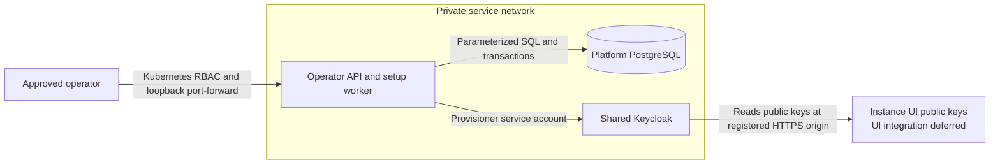

# Platform API and Keycloak security review

**Date:** 2026-11-13

**Scope:** Implemented operator endpoints, PostgreSQL records, setup worker, Keycloak administration client, partner realms and their application registrations. Console code, company SSO enrollment and extension machine authentication are not implemented by this change.

The functionality baseline passed on local Kubernetes before the security review. Security fixes were then checked with unit, database, live Keycloak and end-to-end tests. This review is not a penetration test or a production capacity claim.

## Boundary and sensitive data

The initial API has no application authentication, by explicit decision. Any caller that reaches it has operator authority across the environment. Kubernetes access and the network boundary therefore protect every operation; four-digit IDs, email domains and ownership tags are not authentication. The chart uses ClusterIP, no ingress, deny-all pod ingress, no mounted service-account token, a non-root process and a read-only filesystem. Future console access requires its own authentication and permission enforcement before opening that network boundary.

Platform holds its PostgreSQL password and the Keycloak provisioning service-account secret. PostgreSQL and Keycloak have separate Secret references; either credential can be managed externally without requiring the other in the same Secret. Committed chart values contain no passwords. Platform does not hold UI private keys, employee passwords, extension credentials or company SSO secrets. The UI's private key stays with its deployment; Keycloak reads only public keys. Instance registration accepts approved origins, not credentials or arbitrary JWKS paths.

## Findings and changes

| Finding | Resolution |
| --- | --- |
| Go `1.26.1` and the old `golang.org/x/text` dependency had reachable vulnerability advisories. | Updated to Go `1.26.11` and `x/text` `0.41.0`, including the required `x/sync` update. The image and CI use the same Go patch. `make security` is now a CI gate; the final source scan reports no vulnerabilities. |
| A setup retry did not recheck all owned realm security settings. | It now rejects changed password policy, brute-force protection, password-reset/registration settings, token lifetime and session limits instead of silently accepting or replacing them. |
| New realms had no password-strength requirement. | Keycloak's built-in `length(15)` policy applies from creation. The first administrator is still created manually with a temporary password and only the application role. MFA remains optional by decision. |
| Console clients inherited optional scopes, including offline access. | Console scopes are explicitly `profile`, `email` and `roles`, with no optional scopes. Offline access cannot bypass the ordinary console session limits. Setup retries compare the saved client-scope assignments and reject unexpected changes. |
| Console credentials required per-instance environment references. | Removed the manual secret lookup and secret configuration. Console clients use `private_key_jwt`, RS256, a maximum 60-second assertion lifetime and the instance's registered public-key URL. |
| URL validation duplicated DNS parsing. | Replaced it with Go's URL parser and formatter plus origin, scheme, port and credential restrictions. DNS ownership is an operator approval responsibility; the API does not perform a DNS-ownership check. |

## Follow-up review: 0.2.1

The second adversarial pass kept the realm model, API routes and tenant-creation flow unchanged. It addressed:

| Finding | Change and check |
| --- | --- |
| Availability updates wrote a value and then fetched the row separately. Another update could change the response in between. | Use PostgreSQL `UPDATE ... RETURNING` and one shared row scanner. A concurrent test checks that every response contains its requested value. |
| Bootstrap inspected and disabled an older console client outside the current instance-client model. | Remove that historical cleanup branch. A live test adds an unrelated registration and confirms retries leave it untouched. Ownership and configuration checks still apply to every resource bootstrap actually manages. |
| Helm accepted invalid or unused values until deployment or process startup. | Group existing values without renaming settings or changing defaults. Helm's native JSON Schema rejects bad types, timeout/port ranges, SSL modes, missing connection settings and retired fields. Local chart-owned and externally supplied Secret modes both remain supported. |

## Threat checks

Application definitions are normalized and validated in Go with the existing catalog schema before writes. Unique PostgreSQL indexes enforce app slugs and normalized host-pattern ownership across replicas; the app and host rows commit together. Tests cover concurrent creation retries, slug/host races, stale edit ETags, transaction rollback, schema rejection and UTC timestamps. Local Kubernetes tests exercise two actual replicas, preserve edits through restart, and verify safe `503` responses plus pool recovery after a database outage. Error responses omit SQL details. Registry operations retain the accepted private operator access model; CP integration and existing catalog import are separate changes.

| Threat or failure | Control and evidence |
| --- | --- |
| Create a tenant with a missing or closed instance. | Check the instance inside the creation transaction under a shared row lock. A foreign key enforces the relationship. End-to-end tests reject these requests and confirm no tenant ID is consumed. |
| Create partial ownership records or attach a site to another partner's client. | Save hierarchy, assignment, counters, domain reservations, setup work and the change event in one transaction. Full parent-key constraints reject invalid relationships. |
| Retry a creation concurrently or after a lost response. | Recorded request hashes and a locked counter return the same IDs. Changed input conflicts. Tests cover concurrent instance and partner requests, rollback and exhausted ID ranges. |
| Inject SQL, paths or arbitrary Keycloak operations. | Use parameterized SQL, exact four-digit path parsing, fixed routes and validated Keycloak resource identifiers. Unknown JSON fields and caller-supplied credentials are rejected. |
| Adopt another realm, client or organization after a partial failure. | Verify the saved setup identity and parent before reuse. Matching names are insufficient. Conflicts are reported without overwriting unrelated resources. |
| Keep stale setup work running after another worker takes over. | Expiring lease tokens fence completion and failure updates. Task claims have a five-second deadline; Keycloak attempts have 45 seconds within a 60-second lease and hold no database transaction open. Restart and outage recovery are tested. |
| Forward provisioning credentials to a different server. | The Admin API transport rejects redirects, bounds responses and never follows creation `Location` URLs. Provisioning credentials stay out of UI clients and API responses. |
| Leak submitted secrets through errors or logs. | Return fixed error codes, omit external response bodies and panic values, and keep private Helm values out of Git and image contexts. HTTP bodies are limited to 64 KiB. |
| Reuse a signing proof or use the wrong key, instance or realm. | Live tests reject replayed, expired, wrong-key and wrong-audience assertions. One instance key works in two partner realms; another instance's key is rejected. |
| Bypass login protection with another grant. | Console clients require code flow with PKCE S256. Password, implicit and service-account grants are disabled. The API audience client has all login flows disabled. |
| Keep console access through offline tokens. | Console clients have no optional scopes; offline access is excluded and retry verification rejects its addition. |
| Confuse console users and enrollment identities. | Separate Console and Client SSO realms. Console application roles belong only to the Console realm. Enrollment gives no console role. The SSO realm and initial organization remain disabled until that workflow is implemented. |
| Give MSP administrators Keycloak administration rights. | Manually assign only `platform-api`'s application `admin` role. Do not grant `realm-management` or master roles. The setup API creates no human accounts. |
| Escalate the provisioning account to master administrator. | It needs `create-realm` plus permissions automatically granted for realms it creates. Live SDK tests confirm it can manage its new realms and cannot read full master settings. |
| Replace keys or weaken login settings on a retry. | Verify the registered authenticator, algorithm, key URL, callbacks, client scopes and flows. Tests deliberately change these settings and confirm rejection. |
| Rotate the UI signing key. | Publish overlapping public keys, switch signing to a new `kid`, and account for Keycloak caching. A live JWKS fixture confirms key refresh and signed logout. Key removal does not revoke already-issued user tokens. |
| Store local-time timestamps or trust replica clocks for worker ownership. | Record timestamps use `time.Now().UTC()` in Go and `timestamptz` in PostgreSQL. Tests alter SQL defaults and configure a non-UTC database to prove application timestamps remain correct. Lease deadlines and retry scheduling use the shared database clock. |

Keycloak generated the test realms' signing keys; the live review checked active RS256 keys with RSA sizes of at least 2048 bits. UI signing-key generation and publication remain UI deployment work. Test UI keys were disposable RSA keys, and the fixture served only public keys.

## Outstanding shared-service finding

The existing local Keycloak is `26.6.3`. The infrastructure repository still pins a frozen Bitnami `26.3.3` image. Both predate the security fixes in [Keycloak 26.8.2](https://www.keycloak.org/2026/11/keycloak-2682-released). This is an open deployment finding, not fixed by publishing Platform's image.

Upgrade the shared Keycloak deployment through its own reviewed rollout and database backup. Replacing the existing Bitnami image with a different distribution is not a tag-only change. Follow the [26.8.2 upgrade guide](https://www.keycloak.org/docs/26.8.2/upgrading/), including the `kc-admin-api` client scope required for service accounts that call administration endpoints and the permissions required for protocol-mapper changes. Do not give the provisioner master `admin` to work around those requirements. Retest its effective permissions and new-realm setup on the upgraded server before deployment approval.

This change does not upgrade or restart the shared Keycloak server, change existing human accounts or deploy Platform to AKS. The verified service version for the current end-to-end tests is recorded above. The unresolved server patch must remain visible when planning deployment.

## Deferred enforcement

Console authentication, staff permissions, domain ownership verification, company SSO revocation checks and extension machine credentials belong to the separate authentication implementation. Console domain reservations remain inactive. An email domain is never proof of identity or customer access. A Keycloak refresh token alone does not prove continued access to an external company account.

UI provider selection, issuer binding, assertion generation and public-key publication are unchanged in this work. The bootstrap result reports identity configuration completion, not operational UI readiness. No assignment-fetch, reassignment or revision-acknowledgement API is present.
